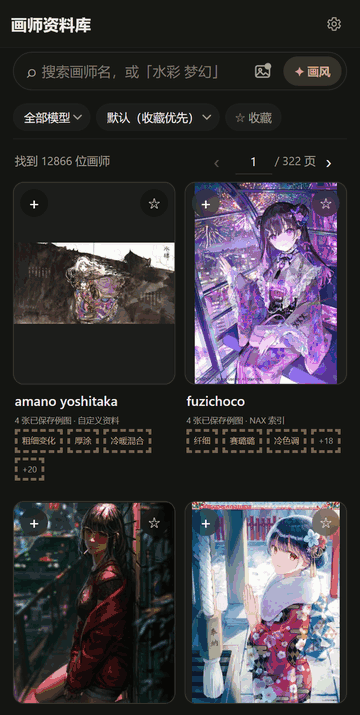
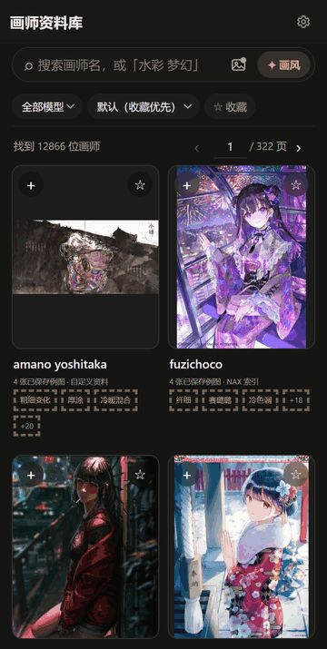
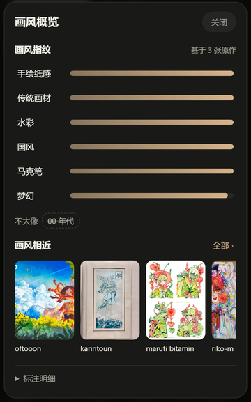
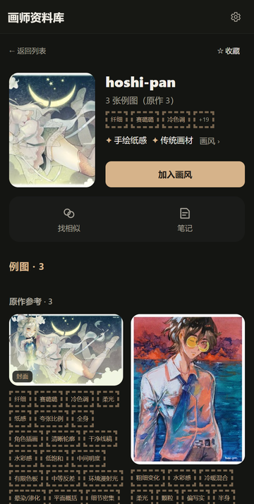
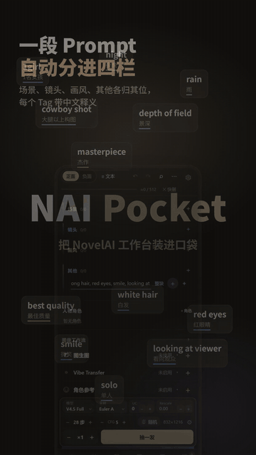
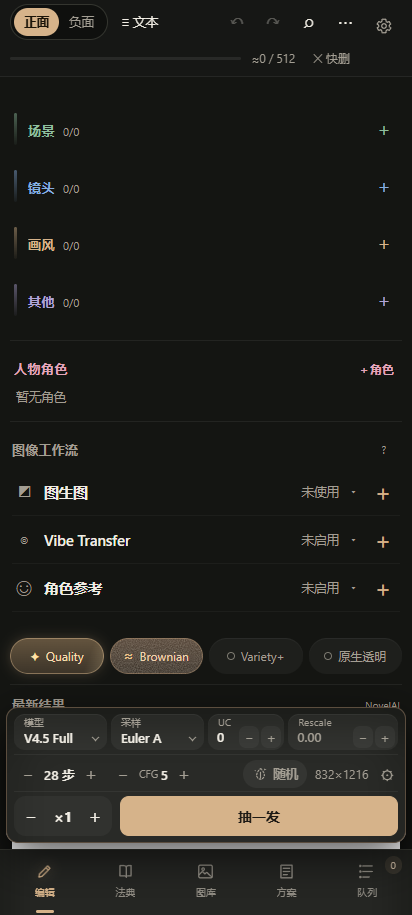
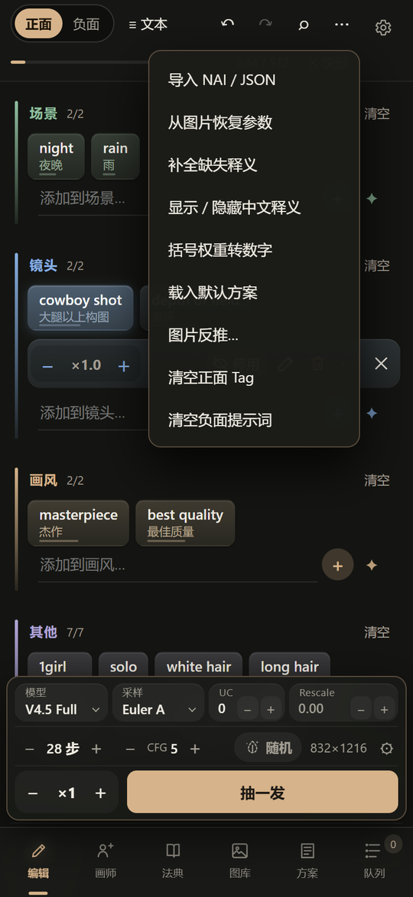
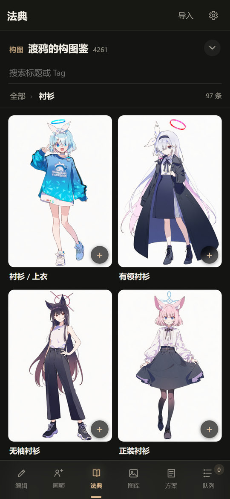
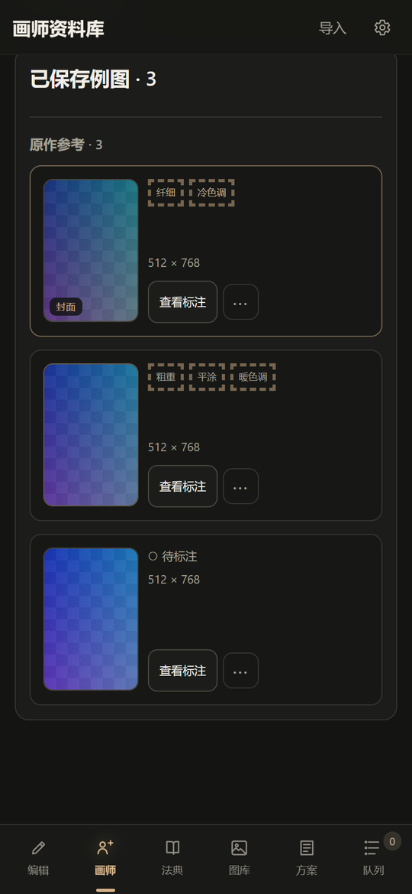

# NAI Pocket

**手机上的 NovelAI 工作台。** 找画风、写 Prompt、排队生成、管理作品，一只手就够。

用你自己的 NovelAI Token，或你选择的第三方中转，在手机本地运行，不需要服务器。

   

## 不知道该用哪个画师？

NovelAI 认得上万个画师名，可光看名字，谁也不知道他画成什么样；例图散在各个网站，一个个去翻太慢。NAI Pocket 把这件事做成了手机上的一个页面：

- **1.2 万+ 位画师的资料库**：其中约 1.1 万位有原作例图和逐图画风标注（线条、上色、色调……），可收藏、写笔记，一键加入画风。
- **V5 例图**：1.2 万+ 位画师每人一张 NovelAI V5 生成图，同一个 Prompt 只换画师名，画风一眼对比；点开可看完整生成参数。
- **按感觉找**：点「水彩」「梦幻」「厚涂」「赛璐璐」等 51 个感觉词，画师按画风接近程度排出来。
- **以图找画师**：选一张喜欢的图，找出画风最接近的画师。
- **画风概览 / 找相似**：每位画师的画风指纹，以及画风最像的几位画师。

画风比较用的是 CLIP 图像模型算出的画风向量（约 1.1 万位画师、2.9 万张全年龄原作），比的是画面本身而不是标签，并尽量排除题材和角色设计的干扰，同一个角色的图，大大减少把「只是画过这个角色」的画师排到前面。全部在手机上离线计算，你选的图片不会上传。

V5 例图、画风数据和以图找画师模型都是可选下载：设置 → V5 例图（约 540 MB）、设置 → 画风数据（约 27 MB）、设置 → 以图找画师（约 293 MB，一次）。

## 还能做什么

### 写 Prompt 不再对着一长串英文
粘贴整段 Prompt，自动分成**场景 / 镜头 / 画风 / 其他**四栏。每个 Tag 是一块带中文释义的积木：点一下调权重，按住拖动排序，随时切回纯文本。多角色的站位在图上点选。

### 和官网一样的生成参数
Quality 质量词、UC 预设（Heavy / Light / Furry Focus / Human Focus）按官网的方式写进请求；V5 Full 可选更省额度的 **Medium**。从 NovelAI 图片（PNG / WebP / JPEG）还原参数时，按当时实际生效的设置还原。

### 找灵感
**法典**里看图挑配方；拿一张图**反推** Tag；从图片里**还原**完整生成参数。

### 生成与管理
文生图、图生图、局部重绘、角色参考、Vibe Transfer 都在。任务进**后台队列**，可暂停、取消、重试；生成的图进入本机**图库**，搜索、收藏、一键恢复参数，并自动存一份到手机相册。常用设置存成**方案**，随时切换、导入导出。局部重绘的**框选高清修补**先圈出上下文再涂改，局部放大生成后贴回原图。

### 官方账号或第三方中转
可以同时保存多个 NovelAI 官方 Token；也可以在「管理第三方中转」里添加 RBQ，或其他与 NovelAI 生图接口兼容的中转，生成时随时切换。自定义中转优先使用 HTTPS；只提供 HTTP 时需在该中转中明确允许（会明文传输 Key、提示词和图片，请只用于你信任的服务与网络）。

## 开始使用

1. 从 [Releases](https://github.com/MayRain-Meow/NAI-Pocket/releases/tag/v0.6.5-preview) 下载 APK 安装。
2. 打开设置添加账号：NovelAI 官方 Token，或在「管理第三方中转」里添加中转。
3. 想找画师：在「设置 → 画师标注资料」下载资料包，在「设置 → 画风数据」下载画风数据（想直接对比 V5 画风，再下载「V5 例图」），然后打开「画师」页。
4. 写好 Prompt，点生成。

有新版本时，应用会自己提示更新。

## 常见问题

**要花钱吗？** 应用免费开源，生成用的是你自己账号的额度。

**隐私呢？** Token 加密保存在手机上，图库和方案也都在本机；生成请求直接发往你选择的渠道，应用本身不设服务器。以图找画师只在手机上运行，图片不上传。

**例图从哪来？** 资料包只含 Danbooru 上全年龄原作的链接和标注，例图打开时从 Danbooru 读取；版权归原作者所有。V5 例图是用 NovelAI V5 Full 生成的图，每张都附生成参数。

**遇到问题？** 欢迎提 [Issue](https://github.com/MayRain-Meow/NAI-Pocket/issues)。

## 开发者

构建、源码结构与测试见 [BUILD.md](BUILD.md)；手机调试见 [体验与调试说明](app/docs/REVIEW.public.md)；资料包格式见 [资料包说明](app/docs/ARTIST-PACK.public.md)。

## 致谢

- **[DanbooruSearch](https://huggingface.co/spaces/SAkizuki/DanbooruSearch)**（SAkizuki）：用中文或一句描述就能搜到 Danbooru Tag，编辑器里的语义搜索由它提供。同一位作者的 **[问秋月](https://huggingface.co/spaces/SAkizuki/WenQiuYue)** 可以问写法，也能让 Agent 帮你把想法写成提示词。
- **[法典 · QuickTagCloud](https://novelai.quicktagcloud.com/)** 以及各部法典的整理者与投稿者：「法典」页读取的就是这些社区配方，条目保留原作者署名。

## 许可

[AGPL-3.0-only](LICENSE) 开源。本项目与 NovelAI 官方无隶属关系；第三方服务与数据的署名见 [THIRD-PARTY-NOTICES.md](THIRD-PARTY-NOTICES.md)。
