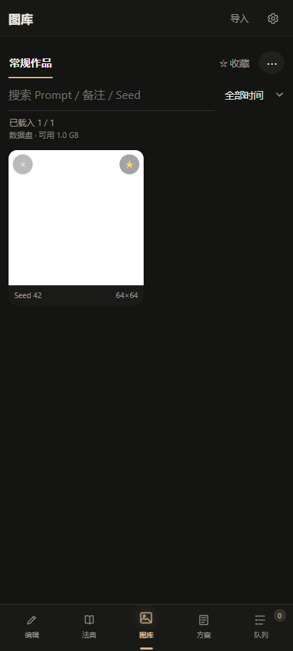

# NAI Pocket

把 NovelAI 的 Prompt、图片参数和生成记录放进口袋。

NAI Pocket 是一款本机运行的 Android 客户端：双语 Tag 编辑、角色与参考图工作流、持久化队列、离线图库和方案管理共用一套 JavaScript 核心。使用者自行配置 NovelAI 官方 Persistent API Token 或 RBQ 凭据，无需部署服务器。

当前处于 **0.2.0 preview 预览阶段**，尚非正式稳定版。内置选定资料中 12,866 位画师的轻量名字／别名索引，未下载资料包也可搜索、收藏和加入画风；本项目不分发画师原作例图；应用保留资料包读取器，可导入自行准备的资料包，校验后安装。APK 和源码 ZIP 都不含画师图片。早先的 0.1.0 APK 不含这些后续修改。本地合成数据集成检查已通过；真实设备上的生成、下载、后台持续运行与系统文件选择，以及真实付费生成仍未验证。

 

截图来自 412 像素宽的离线浏览器检查；图库白图为合成测试图片，不是设备实拍或真实生成结果。

## 功能

- Tag 分组、权重、双语释义、角色 Prompt 与参数编辑。
- 文生图、Img2Img、Inpaint、Precise Reference、Vibe Transfer 及官方图片工具。
- 本机 SQLite 队列；暂停、取消、手动重试、账号切换与 429 冷却。
- 原图、缩略图与预览分开保存；图库搜索、收藏、备注和参数恢复。
- PNG 参数读取、去元数据副本、方案导入导出。
- QuickTagCloud 法典、WD Tagger 反推与公共 Danbooru Tag 搜索。
- 画师名单与别名搜索、本机收藏／备注、加入画风提示词；已安装资料的原作例图、逐图标注、来源与 AI／人工状态，以及按标注筛选。NAX 参考可单独联网查看。可通过安卓文件选择器导入自备的 ZIP 资料包，或填写自己的资料目录链接下载，有进度和取消操作；不需要生成 Token，完成后可离线查看。源码不附带真实画师图片或私有采集工具。

生成需要网络及有效的上游账号。离线可编辑、管理已保存的方案和图库。反推会把所选图片上传到公共 WD Tagger 服务；公共搜索和翻译会发送相应文本。客户端不提供生成额度。

## 安装与使用

1. 安装与本版本源码配套的 APK，或按照下文自行构建。
2. 打开右上角设置，选择官方或 RBQ，添加该渠道自己的 Token。NovelAI 官方使用 `pst-…` Persistent API Token；RBQ 使用自己的 RBQ 凭据。
3. 编辑 Prompt 和参数，确认账号、尺寸与批量数量后生成。
4. 图库下载通过 Android 系统文件选择器保存；方案页可导出方案、片段和画师收藏/备注备份，不包含 Token、原图或在线例图。

Token 由 Android Keystore 加密后保存在应用私有目录，数据库与图片也在本机。卸载会移除这些数据；请提前导出所需图片和备份。导入备份时，同名画师的收藏和备注以备份为准，未包含的本机记录保留；旧版备份也可导入。收到图片后发生本地保存错误，不会自动再次请求生成。应用进程中断的运行中任务会标为失败，由用户决定是否重试。

本项目**不提供**画师例图资料包：例图来自第三方作品，涉及版权与内容分级，不适合随开源项目分发。应用默认不配置任何资料来源。如需使用资料包读取器，请自行准备符合版权要求的资料，格式见[资料包说明](app/docs/ARTIST-PACK.public.md)。

RBQ 的未缓存 Vibe 参考编码需要另外选择官方账号并确认消耗；官方图片工具需要官方账号。不熟悉调试时，按 [体验与手机调试说明](app/docs/REVIEW.public.md) 先看电脑预览，再检查手机行为。

本项目与 NovelAI 无隶属关系。第三方服务及数据的署名见 [THIRD-PARTY-NOTICES.md](THIRD-PARTY-NOTICES.md)。

## 构建

需要 Node.js 22.5 或更新版本、JDK 21、Android SDK Platform 36 和 Build Tools 36。配置 `JAVA_HOME` 与 `ANDROID_HOME`，并接受 SDK 许可证。

```sh
cd app
npm ci
npm run android
```

debug APK 位于 `app/android/app/build/outputs/apk/debug/app-debug.apk`。首轮构建会下载 Gradle 与 Android 依赖。

发布构建使用 `npm run android:release`。若未配置签名环境变量，会产出 unsigned APK。配置说明见 [BUILD.md](BUILD.md)；签名密钥不得提交到仓库。

## 结构

```text
public/             共用编辑器 UI、参数、PNG、Tag 与法典协议
service/            账号、生成、队列、图库、翻译及其他业务服务
service/storage/    同步与异步 SQLite 共用的事务程序
app/src/            本机 API、文件、图像、凭据和 HTTP 适配
app/android/        Android Keystore、HTTPS、通知与文件导出
```

业务层通过注入的存储、文件、图像、HTTP、时钟与 ID 接口运行。队列和请求协议不依赖 Android 或 Node；宿主适配器负责平台操作。

## 检查

```sh
npm test
cd app
npm run build
npm audit
```

离线集成检查还需要 Chrome 和 Playwright：设置 `PLAYWRIGHT_MODULE` 指向其 `index.mjs`，运行 `npm run test:offline`。它使用真实浏览器和临时 SQLite/文件，模拟原生桥与上游响应，不消耗生成额度。它不能代替 Android Keystore、系统生命周期和真实网络的设备验收。

## 许可

项目代码采用 [AGPL-3.0-only](LICENSE)。第三方代码与数据保留各自许可；法典在运行时访问，画师图片和标注作为独立资料下载，不因代码采用 AGPL 而改变其权利归属。
